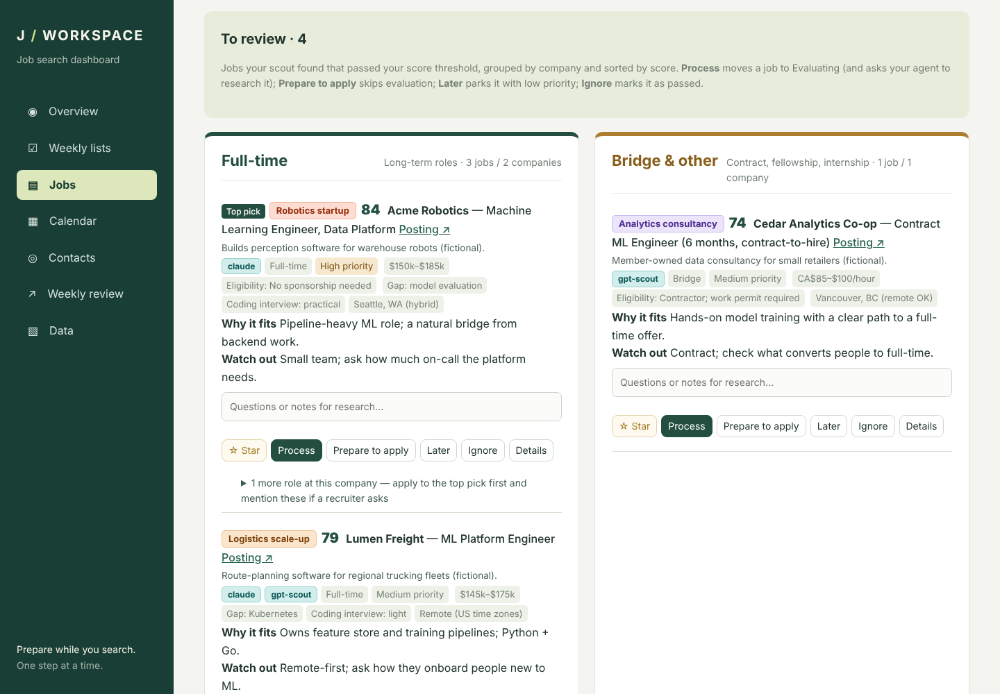
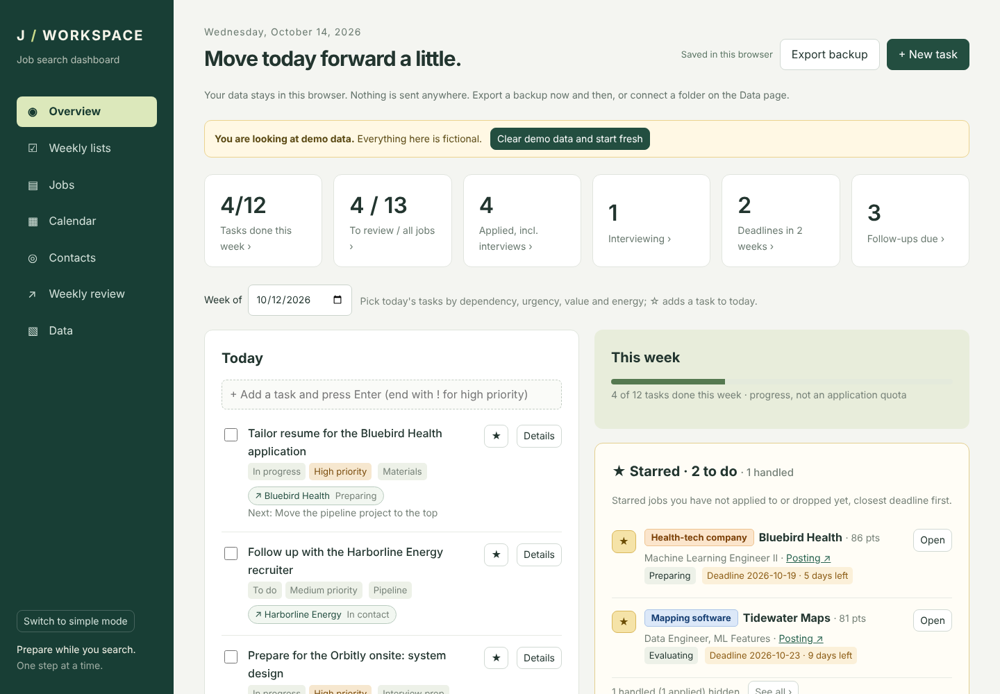
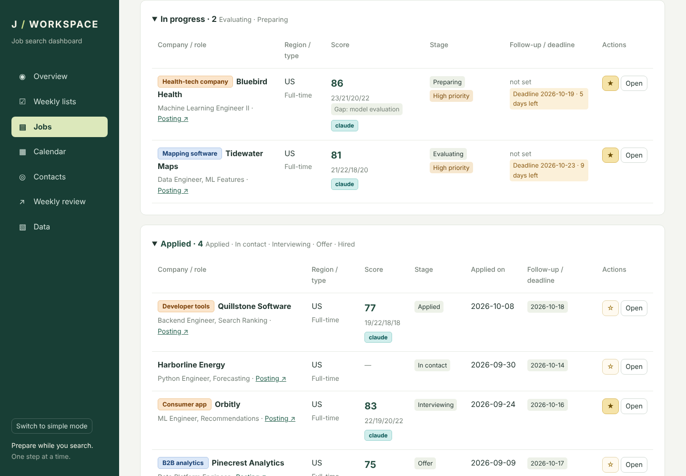
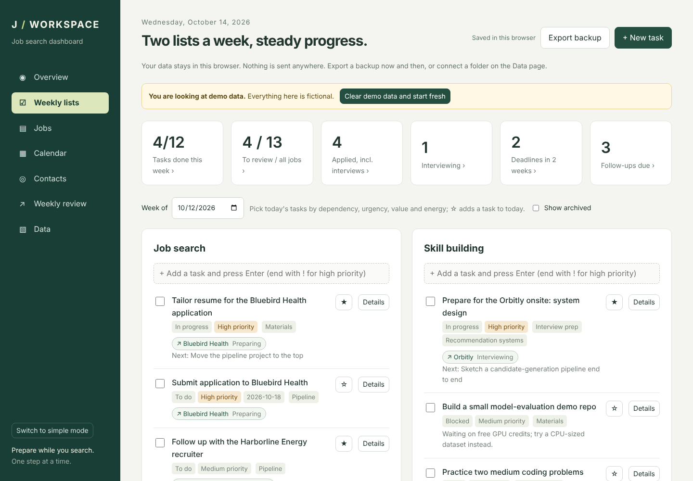
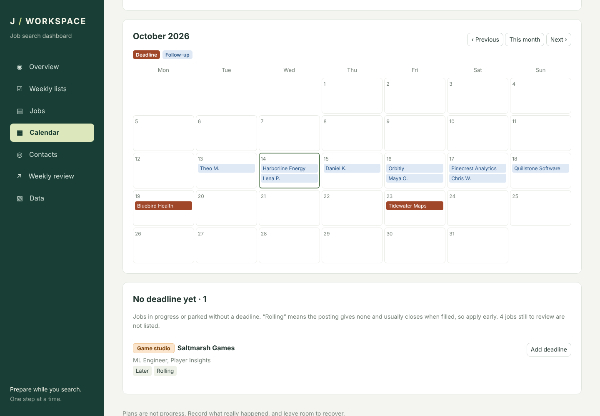
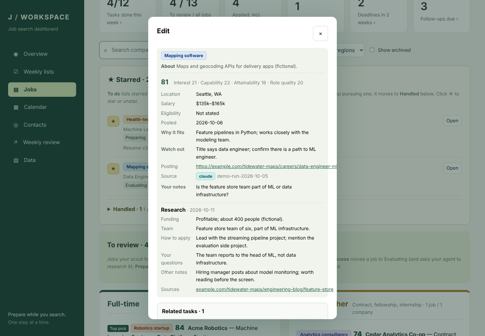
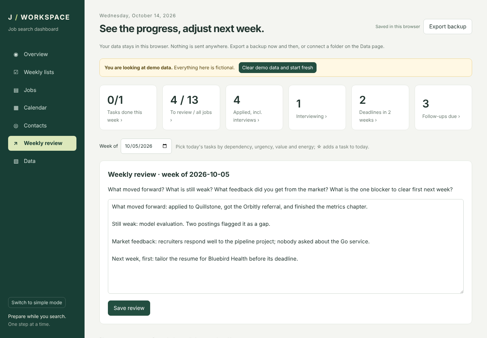
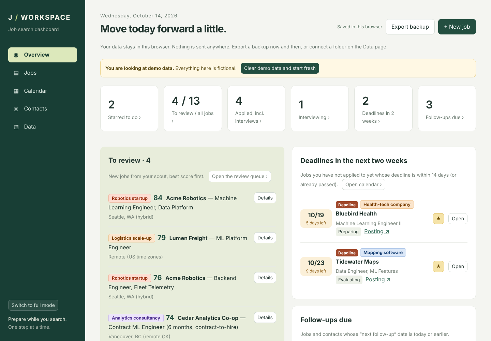

# Job Search Dashboard

**A job search that remembers your decisions.**

An AI agent can find you twenty promising roles in an afternoon. The hard part comes after: deciding which ones deserve your time, remembering what you already ruled out, and not letting a deadline or a follow-up slip while you prepare for the next interview.

This dashboard is the place where those decisions happen. Your agent brings a shortlist, with a score for each role, why it might fit, and what to watch out for. You decide in one click what to pursue, then track applications, deadlines, contacts and follow-ups in the same place. When you sync, your decisions go back to the agent, so the next scout run can skip what you have already seen.

I built it for my own job search, so it also has weekly planning for the days when the search feels endless. If you only want to track applications, there is a simple mode. It works with any AI agent, or with none at all: you can add jobs by hand.

It runs on your computer. No account, no server to host, nothing to install for the dashboard itself.

*Designed by [Fanqi Wang](https://github.com/FanqiWang), built with [Claude Code](https://claude.com/claude-code). See [About](#about).*



<sub>All screenshots use fictional demo data.</sub>

## What you get

- **A review queue that respects your time.** New roles arrive grouped by company and sorted by score. Each one shows why it might fit, what to watch out for, salary, location and skill gaps. **Process**, **Prepare to apply**, **Later** or **Ignore**: one click each.
- **A pipeline you can see at a glance.** Every role you are pursuing, from evaluating to offer, with deadlines and your own follow-up dates.
- **Nothing falls through the cracks.** Deadlines in the next two weeks and follow-ups that are due show up on the front page and on a calendar.
- **A memory across searches.** Your decisions are recorded in a ledger, so a role you passed on last month does not come back next week.
- **A week you can plan** (optional). Two task lists a week, one for the search and one for building skills. Unfinished tasks carry over instead of quietly disappearing, and a short weekly review helps you notice what is working.
- **Your data stays yours.** Everything lives in your browser and, if you want, in a folder on your computer. Nothing is uploaded anywhere.

## Quick start

**Just look around.** Download this repository (the green **Code** button → **Download ZIP**, then unzip it) or clone it, and double-click `app/index.html`. It opens with fictional demo data, so you can click around right away. When you are ready to start for real, click **Clear demo data and start fresh** in the banner at the top.

```sh
git clone https://github.com/FanqiWang/job-search-dashboard.git
```

**Connect it to your AI agent (folder sync).** For the agent to see your decisions, the dashboard needs to read and write files in this folder. Start the small local server included in the project and use Chrome or Edge:

```sh
cd job-search-dashboard
python serve.py          # or: python3 serve.py
```

Your browser opens <http://localhost:8765/app/> (open it yourself if it does not). Then:

1. Go to **Data** and click **Clear demo data and start fresh**. Folder sync stays paused while demo data is loaded, so demo jobs never end up in your files.
2. Click **Connect folder**, choose the `job-search-dashboard` folder (the one that contains `app/` and `data/`), and allow access.
3. Make any change, for example add a job. If a file `data/state/dashboard-state.json` appears in the folder, sync is working.

From then on the dashboard saves a copy of everything to that file a moment after each change. It imports new jobs from `data/scout/` when you connect, when you reopen the page and allow access again, or when you click **Import inbox now** on the Data page. The browser asks for permission on each visit; click **Allow folder access** in the banner. Stop the server with `Ctrl+C` in the terminal.

No Python yet? Install it from [python.org](https://www.python.org/downloads/). On Windows, tick "Add Python to PATH" during setup. `serve.py` uses only the standard library and listens on `127.0.0.1`, so nothing is reachable from other computers. Any static server works too, as long as it serves this folder on `localhost`:

```sh
python -m http.server 8765 --bind 127.0.0.1    # then open http://localhost:8765/app/
```

> **Why a server?** Browsers only let web pages read and write local folders on secure addresses such as `http://localhost`, not on files opened by double-clicking. Everything else works without it.

## How it works

**Scout → review → track → sync, then the next scout run starts from what you decided.**

1. **Scout.** Ask an agent to read your profile, search job sources, check the official postings, and produce a scored shortlist. The included [scout instructions](workflow/job-scout/SKILL.md) score four things from 0 to 25 each: how interested you would be, how well you can do the job, how attainable it is, and how good the role is. The scores help you decide what to look at first. They are not a prediction of whether you will get hired.

2. **Review.** The shortlist lands in the **To review** queue. **Process** moves a role to *Evaluating*, **Prepare to apply** moves it to *Preparing*, **Later** parks it with low priority, and **Ignore** marks it *Passed*. If you want the agent to research a role, write your questions in the note box and ask it separately.

3. **Track.** Update stages as things move (*Applied → In contact → Interviewing → Offer*), add deadlines, follow-up dates, notes and contacts, and star the roles you care about most. Full mode also gives you weekly task lists and reviews.

4. **Sync.** `sync_decisions.py` records changed decisions in `data/scout/ledger.jsonl` and removes the jobs you have already imported from the inbox. Before the next run, the agent reads the ledger, and `publish.py` also filters its results against your saved dashboard and the ledger.

Under the hood, the agent and the dashboard only exchange local files. The publishing script checks required fields, score arithmetic, declared eligibility and posting age, and drops roles you already have. Files are replaced atomically, so a crash never leaves half an inbox behind, and running a sync twice changes nothing the second time. Checking that a posting is real and assessing fit remain the agent's job. See [Architecture](docs/architecture.md) for the details.

## Screenshots

<table>
  <tr>
    <td width="50%"><br><b>Overview.</b> Today's tasks, starred roles, upcoming deadlines and follow-ups on one page.</td>
    <td width="50%"><br><b>Pipeline.</b> Every role from evaluation through application and interviews, with deadlines and follow-up dates.</td>
  </tr>
  <tr>
    <td><br><b>Weekly lists.</b> Job-search tasks and interview preparation side by side. Unfinished tasks carry over, and tasks link to the jobs they mention.</td>
    <td><br><b>Calendar.</b> Application deadlines and planned follow-ups, by urgency or on a monthly calendar.</td>
  </tr>
  <tr>
    <td><br><b>Job details.</b> The agent's assessment next to your own questions and any research notes it adds.</td>
    <td><br><b>Weekly review.</b> What changed this week, where you are stuck, and what to try next.</td>
  </tr>
</table>

## Full or simple

Not interested in planning your week inside the dashboard? Switch to **simple mode** with the button at the bottom of the sidebar, or on the Data page.

Simple mode keeps the review queue, your pipeline, deadlines, follow-ups and contacts, and hides the weekly task lists, workstreams and weekly reviews. Both modes use the same data, so you can switch back at any time without losing anything. You can also open the page as `app/index.html?mode=simple`.



## Connect your AI agent

The dashboard does not care which AI you use. It only reads and writes documented files: the agent writes recommendations as JSON and reads your decisions back from the saved state and the ledger.

For the workflow below, the agent needs to be able to search job sources, read and write files in this folder, and run Python scripts. Coding agents such as Claude Code can do all three. With a chat app or a local model that cannot, you can still copy the files back and forth by hand, or write a small script to do it.

| The agent… | File | Format |
|---|---|---|
| reads your profile | `workflow/profile.md` | free text ([example](workflow/profile.example.md)) |
| writes new jobs | `data/scout/inbox.json` or `data/scout/inbox-<engine>.json` | [inbox](docs/data-formats.md#inbox) |
| optionally writes research | `data/scout/research.json` | [research notes](docs/data-formats.md#research-notes-optional) |
| reads your decisions | `data/state/dashboard-state.json`, `data/scout/ledger.jsonl` | [state](docs/data-formats.md#dashboard-state), [ledger](docs/data-formats.md#ledger) |

From the repository folder:

1. Copy `workflow/profile.example.md` to `workflow/profile.md` and describe yourself: experience, the roles you want, locations, deal-breakers.

2. Give your agent the two skills, [`workflow/job-scout/SKILL.md`](workflow/job-scout/SKILL.md) and [`workflow/dashboard-sync/SKILL.md`](workflow/dashboard-sync/SKILL.md). Agents that support skill folders, such as Claude Code, can use them as they are; for others, paste the steps into your prompt. They are short on purpose, so edit them to fit your search.

3. Ask the agent to "run a scout". It writes its results to a file such as `results.json`, then checks them and publishes them to the inbox:

   ```sh
   python workflow/dashboard-sync/scripts/publish.py --results results.json --engine my-agent --write
   ```

4. Click **Import inbox now** on the Data page and review the new roles. Check that the Data page shows no save error, then ask the agent to sync your decisions:

   ```sh
   python workflow/dashboard-sync/scripts/sync_decisions.py --engine my-agent --write
   ```

Both scripts only print what they would do unless you pass `--write`, so you can always look first.

**Using more than one agent?** Give each its own `--engine` name; each gets its own `inbox-<engine>.json`, and the dashboard shows which agent suggested which role. When two agents suggest the same role (the same `opportunity_id`), the dashboard keeps both sources and both scores. Since `publish.py` skips roles that are already on the dashboard, publish both shortlists before you import if you want to compare their scores.

## Privacy

- **Your job data stays on your computer.** The dashboard does not upload anything, load third-party services, or include analytics. The only time it touches the internet is when you open a posting link.
- **AI services have their own rules.** If you give a cloud agent access to your profile or job files, whatever it reads may be sent to its provider under that provider's terms.
- **Back up now and then.** The main copy lives in your browser's `localStorage` for this page; clearing browser data deletes it. **Export backup** downloads everything as one file, and folder sync keeps a copy in `data/state/`.
- **Folder access is your choice.** The dashboard can only touch the folder you pick, and the browser asks again on later visits.
- **Nothing is encrypted by this app.** Treat your profile, contacts, notes and backups like any other personal file.
- **Your files stay out of Git.** `workflow/profile.md` and everything under `data/` (except the included example) are git-ignored, so you can fork this repository without publishing your search. Still check before committing: ignore rules do not remove files you already committed, or your Git history.

## FAQ

**Can I use it just to track applications?**
Yes. Switch to simple mode (see [Full or simple](#full-or-simple)). Your choice is remembered in this browser.

**Do I need an AI agent?**
No. Add jobs, contacts and tasks by hand with the **+ New** button. The agent just fills the review queue for you.

**Which browsers work?**
Any current desktop browser runs the dashboard. Folder sync needs Chrome or Edge and the page served from `localhost`; Firefox and Safari do not support writing to local folders.

**Where is my data, and how do I move it?**
In your browser, tied to the page's address: `file://…/app/index.html` and `http://localhost:8765/app/` count as two different places. Export a backup from one and import it in the other. With folder sync connected, `data/state/dashboard-state.json` is updated shortly after each change.

**How do I get rid of the demo data?**
Click **Clear demo data and start fresh** in the banner, or use the **Data** page. You can load the demo again from the same page; your current data is downloaded as a backup first.

**Can I change the stages, lists or scoring?**
The vocabulary lives at the top of [`app/js/model.js`](app/js/model.js). If you rename stages, update `STATUS_MAP` in [`sync_decisions.py`](workflow/dashboard-sync/scripts/sync_decisions.py) to match. Scoring is up to your scout: `publish.py` only checks that each of the four parts is between 0 and 25 and that they add up to the total. Use `--min-score` and `--max-age-days` to adjust its filters.

**What is a "Bridge" job?**
A contract, fellowship, residency or other short-term role that gets you closer to where you want to be. Bridge roles, internships and anything else that is not full-time get their own column in the review queue.

**Is there a build step?**
No. Edit a file and reload the page. The app is plain HTML, CSS and JavaScript; the scripts are plain Python 3.9+.

## Development

```sh
node --test "tests/js/*.test.js"                              # dashboard logic, no packages needed
python -m unittest discover -s workflow/dashboard-sync/tests  # sync scripts, standard library only
npm install && npx playwright install chromium && npm run screenshots   # regenerate docs/images/
```

See [`docs/architecture.md`](docs/architecture.md) for how the code is organized, and [`docs/data-formats.md`](docs/data-formats.md) for every file format.

## About

I'm [Fanqi Wang](https://github.com/FanqiWang). This project grew out of the dashboard I used for my own job search. I designed the workflow and how it behaves: reviewing recommendations, keeping the next step in view, and remembering decisions for the next search.

[Claude Code](https://claude.com/claude-code) wrote the code, tests, documentation and screenshots from my specifications and reviews. Codex reviewed and refined this README, checked its technical claims against the implementation, and ran the existing dashboard-logic and Python workflow tests.

## License

[MIT](LICENSE)
